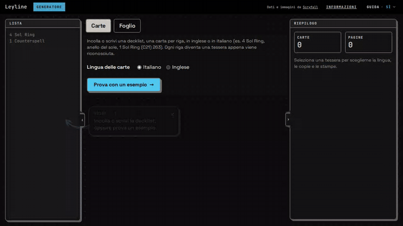
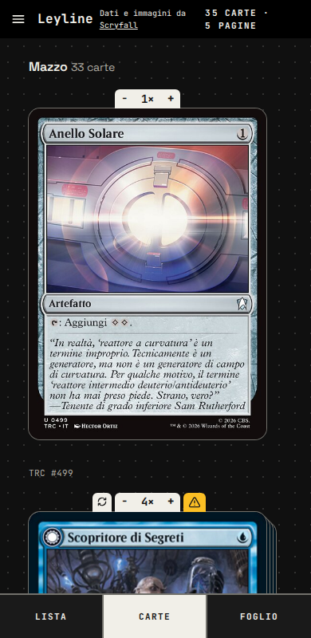
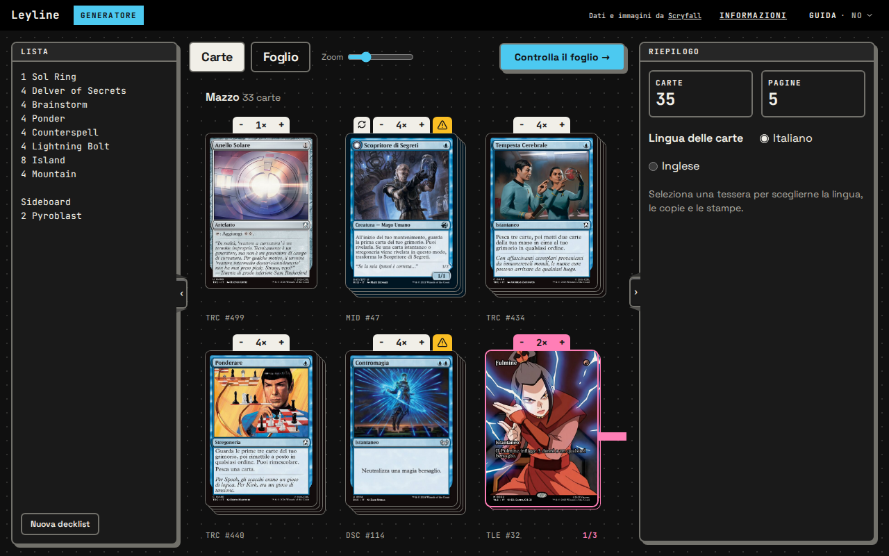
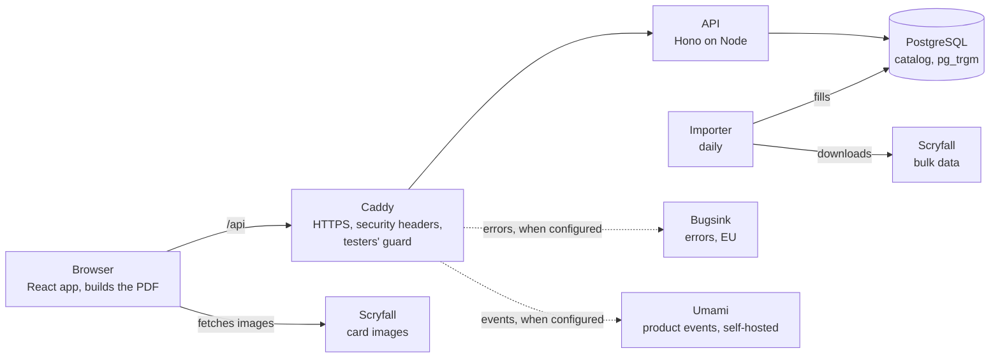

# Leyline

[](https://github.com/mattesalva93/leyline/actions/workflows/ci.yml)

Leyline turns a Magic: The Gathering decklist into a printable sheet of proxies: paste the list, pick the prints, download the PDF.

**Try it at [leyline.website](https://leyline.website)** · [latest release](https://github.com/mattesalva93/leyline/releases/latest) · [changelog](CHANGELOG.md)

Unofficial, not affiliated with Wizards of the Coast. Card data and images come from [Scryfall](https://scryfall.com).

<p align="center">
  
</p>

<p align="center">
  
  
</p>

## Status

Open alpha: the first module, the proxy sheet generator, is online for anyone, with no account. The version online is the [latest release](https://github.com/mattesalva93/leyline/releases/latest); what each release changes is in the [changelog](CHANGELOG.md), in Italian. To report a vulnerability, see [`SECURITY.md`](SECURITY.md).

## What it does

A [proxy](GLOSSARY.md) is a printed stand-in for a card, slipped into a sleeve to play or test a deck. Leyline prints them at real card size, a sheet at a time, ready to cut.

- Recognises card names written in English or Italian, even misspelled, line by line, and flags the lines to fix.
- Lets you pick the print and the language of every line, and split its copies across several prints.
- Lays the cards out on an A4 or Letter sheet with crop marks, with a preview of every page.
- Builds the PDF in your browser.

The words this README uses for the app's parts (line, print, tile, sheet) are defined in [`GLOSSARY.md`](GLOSSARY.md).

## How it's built

React and Vite in the browser, Hono on Node for the API, PostgreSQL for the catalog, Caddy in front, all in Docker Compose on one EU VPS. Each choice below links to the decision record that explains it.

- **The PDF is built in the browser.** The sheet layout and the PDF are a pure function in `core`; the browser fetches the images from Scryfall and the server never touches them ([ADR 0001](docs/adr/0001-pdf-generated-in-core-run-in-browser.md)).
- **Names are recognised by trigram search.** PostgreSQL's `pg_trgm` matches English and Italian names, misspellings included ([ADR 0003](docs/adr/0003-postgresql-with-pg-trgm.md)).
- **A security baseline from day one.** A recognised verification standard, hardened containers and an API that defends itself ([ADR 0016](docs/adr/0016-security-baseline-for-the-alpha.md)).
- **CI checks the supply chain**: the actions it runs, the dependencies and the images ([ADR 0017](docs/adr/0017-ci-checks-the-supply-chain.md)).
- **`main` is protected, and every merge is a release.** Nobody pushes to `main` ([ADR 0006](docs/adr/0006-main-protected-by-local-git-hooks.md)); GitHub lets in only pull requests that pass CI, and a feature of several tickets gathers on a spec branch first ([ADR 0024](docs/adr/0024-a-multi-ticket-spec-lands-on-main-through-a-spec-branch.md)).
- **One version, written with its changelog entry** in the pull request that releases it, and an invitation to reload for a page left open on an older release ([ADR 0025](docs/adr/0025-one-app-version-written-with-its-changelog-entry.md)).
- **Monitoring stays self-hosted or in the EU.** Errors go to Bugsink and product events to a self-hosted Umami, both through the site's own origin and without the user's text or address ([ADR 0027](docs/adr/0027-self-hosted-analytics-and-eu-error-monitoring-behind-the-sites-own-origin.md)).

## Architecture



Dashed arrows are off until their configuration is filled in. The browser sends its errors and events to the site's own origin and the API its errors to Caddy, which forwards them.

## Roadmap

- **Now:** the analysis of the deckbuilder, the next area of the app, begins ([ADR 0028](docs/adr/0028-leyline-is-a-modular-monolith.md)).
- **Next:** the deckbuilder, as a new area of the same app beside the proxy sheet generator ([ADR 0028](docs/adr/0028-leyline-is-a-modular-monolith.md)).
- **Later:** a collection manager, an assistant for deck building, and a wiki of keywords and banlists ([ADR 0028](docs/adr/0028-leyline-is-a-modular-monolith.md)).

## Getting started

Requires [mise](https://mise.jdx.dev) and Docker.

```sh
mise install          # node and pnpm at the pinned versions
pnpm install          # also installs the git hooks
cp .env.example .env
pnpm db:up            # PostgreSQL with pg_trgm, a database of its own apart from staging's
pnpm import:catalog   # download Scryfall's all_cards bulk (~400 MB) and fill the catalog
pnpm dev              # api on 127.0.0.1:3000, web on http://127.0.0.1:5173
```

### Checks and previews

```sh
pnpm check                # typecheck, lint, format, theme, unused code, tests (what CI runs; needs db:up)
pnpm build                # production build of web and api
pnpm sheet:preview        # render a sample sheet to .preview/sheet-*.png (needs pdftoppm: brew install poppler)
pnpm web:preview          # screenshot the running app at phone and desktop widths into .preview/web-*.png
pnpm web:demo             # record the running app's flow as the GIF above (needs ffmpeg: brew install ffmpeg)
pnpm check:phone-width    # check in the running app that the phone workspace never outgrows the screen
pnpm check:staging --access open   # check on the running staging stack what lives in its configuration
```

Each of these scripts explains its options in its first lines. The screenshots above are `pnpm web:preview` shots copied into [`docs/media/`](docs/media/).

To run the whole production stack locally as staging, see [`docs/staging.md`](docs/staging.md). `main` deploys to the alpha's VPS once CI passes on it: see [`docs/deploy.md`](docs/deploy.md).

## Repository layout

- `packages/core`: the domain rules (decklist resolution, prints, allocation, sheet layout and PDF), with no I/O. Its public interface is `src/index.ts`.
- `packages/api`: the HTTP API over the catalog, and the Scryfall importer.
- `packages/web`: the browser app.

Inside each package, code is grouped in folders by feature: see "Folders by feature" in [`CODING_STANDARDS.md`](CODING_STANDARDS.md).

## Documentation

- [`GLOSSARY.md`](GLOSSARY.md): what each domain word means.
- [`docs/adr/`](docs/adr/): the decisions and why they were taken.
- [`CODING_STANDARDS.md`](CODING_STANDARDS.md): the rules a review checks.
- [`docs/staging.md`](docs/staging.md), [`docs/deploy.md`](docs/deploy.md), [`docs/debugging.md`](docs/debugging.md): running, deploying and debugging.
- [`research/`](research/): dated background research the decisions cite.
- [`AGENTS.md`](AGENTS.md): how coding agents work in this repo.

## License

[MIT](LICENSE)
